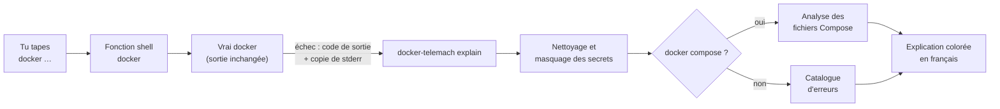

# TELEMACH PLUGIN DOCKER

**TELEMACH** est un plugin pédagogique pour Docker : quand une commande `docker` ou
`docker compose` échoue, il t'explique **en français** ce qui s'est passé, le concept Docker
en jeu, la cause probable et comment corriger, avec une sortie largement colorée.

```text
$ docker run -p 8080:80 nginx:1.30-alpine
docker: Error response from daemon: … Bind for 0.0.0.0:8080 failed: port is already allocated

✖ Le port 8080 de ta machine est déjà utilisé.

📘 Concept — port publishing
   L'option « -p PORT_MACHINE:PORT_CONTENEUR » relie un port de ta machine à un
   port du conteneur. Un port de la machine ne peut être relié qu'une seule fois.

🔎 Cause probable
   Un autre conteneur (ou un autre programme de ta machine) écoute déjà sur le port 8080.

💡 Corrections
   1. Voir quel conteneur publie déjà ce port.
      docker ps --filter publish=8080
   2. Publier le conteneur sur un autre port de ta machine.
      docker run -p 8081:80 nginx:1.30-alpine

➜ Pour aller plus loin : docker telemach deepen
```

## Le projet

Quand on apprend Docker, les erreurs arrivent vite, et elles sont écrites en anglais
technique : `Bind for 0.0.0.0:8080 failed`, `pull access denied`, `mapping values are not
allowed in this context`… Le message dit **ce qui** a échoué, rarement **pourquoi**, et
encore moins **ce qu'il faut comprendre** pour ne plus refaire l'erreur.

TELEMACH transforme chaque erreur en petite leçon. Le nom vient de Télémaque, le fils
d'Ulysse, guidé par Mentor dans *l'Odyssée* : le plugin joue ce rôle de mentor, au moment
précis où tu en as besoin, dans ton propre terminal.

Il s'adresse aux personnes qui débutent ou progressent avec Docker : étudiants, développeurs
qui découvrent les conteneurs, formateurs qui veulent un compagnon pour leurs travaux
pratiques.

## Le concept

### Une erreur = une leçon en quatre temps

Chaque explication suit toujours la même structure, pour que l'apprenant prenne l'habitude de
raisonner ainsi :

| Bloc | Rôle |
|------|------|
| ✖ **Résumé** | ce qui s'est passé, en une phrase |
| 📘 **Concept** | la notion Docker en jeu (image, conteneur, port, volume, réseau…), définie simplement |
| 🔎 **Cause probable** | pourquoi c'est arrivé ici |
| 💡 **Corrections** | ce que tu peux faire, avec la commande prête à copier |
| ⚠ **Anti-pattern** | la « solution rapide » à éviter, et pourquoi (`chmod 666`, `rm -f`…) |
| ➜ **Pour aller plus loin** | `docker telemach deepen` : le concept détaillé, un exemple, un exercice |

Si la même erreur se répète dans les 10 minutes, TELEMACH n'affiche qu'un rappel court ;
`docker telemach last` réaffiche alors l'explication complète.

Le message Docker d'origine reste affiché, atténué, avec les éléments importants (port,
image, chemin) surlignés : on apprend aussi à lire soi-même les erreurs Docker.

### Trois principes

- **Ne jamais inventer.** Une erreur inconnue est présentée comme telle, avec des pistes et
  un lien vers la documentation officielle, mais sans cause supposée.
- **Ne jamais agir à ta place.** TELEMACH propose, tu décides : il ne modifie aucun fichier,
  ne démarre, n'arrête ni ne supprime aucun conteneur ; il se contente de lire.
- **Enseigner les bonnes pratiques.** Les exemples évitent root, `--privileged` et les
  secrets écrits en clair ; une solution dangereuse est toujours signalée comme telle.

### Comment ça marche



1. **Capture.** `shell-init` définit une fonction `docker` dans ton shell. Elle lance le vrai
   `docker` sans toucher à son entrée ni à sa sortie standard, et garde une copie de la
   sortie d'erreur dans un fichier temporaire privé (`0600`), supprimé juste après.
2. **Nettoyage.** Le texte capturé est traité comme non fiable : les séquences de contrôle du
   terminal sont neutralisées et les secrets (mots de passe, jetons, `user:motdepasse@`) sont
   masqués avant tout usage.
3. **Diagnostic.** Le **catalogue** (fichiers YAML en français, embarqués dans le binaire)
   reconnaît l'erreur grâce à des motifs. Le **code de sortie** indique si l'erreur vient de
   Docker (125) ou du programme du conteneur (126, 127, 137, 143 et les autres codes).
4. **Compose.** Pour `docker compose`, l'**analyseur** relit les fichiers Compose en lecture
   seule, avec le parseur officiel `compose-go`, pour pointer le fichier, la ligne et la clé
   exacts.
5. **Rendu.** L'explication est affichée sur la sortie d'erreur, avec un code couleur par
   bloc et la coloration syntaxique des commandes et des extraits YAML.

### Vérifier un fichier Compose avant de le lancer

```text
$ docker telemach check
✖ Problème 1/1 — compose.yaml:4:5
   service « web », clé « services.web.port »
   la clé « port » n'existe pas à cet endroit — tu voulais sans doute écrire « ports »

     1 │ services:
     2 │   web:
     3 │     image: nginx:1.30-alpine
   ➤ 4 │     port:
             ^
     5 │       - "8080:80"

   💡 Version corrigée
     4 │     ports:
```

L'analyse détecte : fichier introuvable ou illisible, tabulations, syntaxe YAML, clés en
double ou inconnues (avec la clé probable), types de valeurs incorrects, services, réseaux ou
volumes non déclarés, dépendances en boucle, variables non définies et secrets écrits en
clair.

### Avertissements sur la ligne de commande

Certaines commandes réussissent sans faire ce que tu voulais. Après une commande
`docker run`, `create` ou `exec` réussie, TELEMACH relit la ligne tapée (sans rien exécuter)
et t'avertit s'il y repère un piège :

```text
$ docker run -d nginx:1.30-alpine -p 8090:80
3f1c…
⚠ Option Docker placée après l'image : -p 8090:80 a été transmis au conteneur, pas à Docker.
   Le conteneur a pu démarrer, mais le port 8090 de ta machine n'est pas publié.

📘 Concept — ordre des arguments de docker run
   docker run [OPTIONS] IMAGE [COMMANDE] [ARG...] : les options de Docker se placent avant
   le nom de l'image ; tout ce qui suit l'image est donné au programme du conteneur.

🔎 Cause probable
   Docker arrête de lire ses propres options dès qu'il rencontre le nom de l'image […]

💡 Correction
   Placer les options de Docker avant le nom de l'image.
   docker run -d -p 8090:80 nginx:1.30-alpine
   Si le conteneur a été créé sans ces options, l'arrêter et le supprimer, puis le relancer
   avec la commande corrigée.
   docker stop <conteneur> && docker rm <conteneur>
```

Les pièges repérés :

| Niveau | Piège | Exemple |
|--------|-------|---------|
| ⚠ | option Docker placée après l'image ou le conteneur | `docker run nginx -p 8090:80`, `docker exec web -it sh` |
| ⚠ | volume nommé au lieu du dossier local (un dossier `data` existe) | `-v data:/app` au lieu de `-v ./data:/app` |
| ℹ | port de la machine choisi au hasard | `-p 80` au lieu de `-p 8080:80` |
| ⚠ | variable d'environnement non définie dans ton shell | `-e DB_HOST` |
| ℹ | image sans tag explicite (une fois par image et par 24 h) | `nginx`, `nginx:latest` |
| ⚠ | ports ignorés en réseau `host` | `--network host -p 8080:80` |
| ⚠ | secret écrit en clair (jamais réaffiché) | `-e DB_PASSWORD=…` |
| ⚠ | privilèges excessifs (anti-pattern) | `--privileged`, socket Docker monté |

En cas de doute, TELEMACH se tait : `docker run postgres:18-alpine postgres -p 5433` ou
`docker run redis:8-alpine redis-server --port 7000` ne déclenchent rien. Si tu refais la même
erreur dans les 10 minutes, tu n'as qu'un rappel d'une ligne, avec la commande corrigée. Si la
commande échoue, le piège est présenté comme cause probable de l'erreur, une seule fois.

Pour vérifier une commande **avant** de la lancer :

```bash
docker telemach lint -- run -d nginx -p 8090:80
```

### Comprendre un conteneur qui s'est arrêté

Un conteneur lancé en arrière-plan peut s'arrêter aussitôt : `docker run -d` a réussi, l'erreur
n'est que dans son journal. Quelques secondes après un `docker run -d`, TELEMACH vérifie l'état
du conteneur et te prévient à l'invite suivante :

```text
$ docker run -d postgres:18-alpine
4f2a…
$
⚠ Le conteneur « eager_pg » s'est arrêté avec le code 1, moins d'une seconde après son lancement : docker telemach ps pour comprendre pourquoi.
```

`docker telemach ps` retrouve alors le dernier conteneur arrêté en erreur, montre la fin de son
journal et en explique la cause :

```text
$ docker telemach ps
✖ Le conteneur « eager_pg » (postgres:18-alpine) s'est arrêté avec le code 1, moins d'une
   seconde après son démarrage (il y a 2 min).
   L'image postgres:18-alpine exige la variable POSTGRES_PASSWORD, absente au lancement.

── Fin du journal (7 dernières lignes) ───────────────────────────────────────
   Error: Database is uninitialized and superuser password is not specified.
          You must specify POSTGRES_PASSWORD to a non-empty value for the
   …

💡 Corrections
   1. Mettre la variable dans un fichier lisible par toi seul (chmod 600), jamais ajouté à
      git, puis le passer avec --env-file.
      docker run -d --env-file db.env postgres:18-alpine
```

Causes reconnues : variable obligatoire absente, option de `docker run` placée après l'image,
commande introuvable ou non exécutable, accès refusé, port déjà utilisé, fichier introuvable,
image d'une autre architecture, manque de mémoire, erreur de démarrage, arrêt par
`docker stop`/`docker kill`, plantage (erreur de segmentation). Sinon, TELEMACH le dit et
t'oriente vers `docker logs`. `docker telemach ps <nom>` explique un conteneur précis ; les
autres conteneurs en erreur sont listés sous l'analyse.

## Installation

### Prérequis

| Outil | Version | Vérification |
|-------|---------|--------------|
| Docker Engine ou Docker Desktop | avec le plugin Compose v2 | `docker version` et `docker compose version` |
| Shell | bash ou zsh (Linux, macOS, WSL2) | `echo $SHELL` |
| `curl` | toute version récente | `curl --version` |

Go n'est **pas** nécessaire, sauf pour compiler depuis les sources. Windows natif (PowerShell)
n'est pas pris en charge ; sous Windows, utilise WSL2.

### 1. Installer le plugin

#### Depuis une Release (recommandé)

Chaque version publie, sur la [page des Releases](https://github.com/aboigues/telemach-plugin-docker/releases),
un binaire par système (Linux, macOS) et par processeur (amd64, arm64), avec un fichier de
sommes de contrôle signé. Télécharge en ligne de commande plutôt qu'avec un navigateur : sous
macOS, un fichier téléchargé par un navigateur peut être bloqué au premier lancement.

Linux et WSL2 :

```bash
VERSION=0.3.0
ARCH=$(uname -m); case "$ARCH" in x86_64) ARCH=amd64 ;; aarch64|arm64) ARCH=arm64 ;; esac
FICHIER=docker-telemach_${VERSION}_linux_${ARCH}
curl -fsSLO "https://github.com/aboigues/telemach-plugin-docker/releases/download/v${VERSION}/${FICHIER}"
curl -fsSLO "https://github.com/aboigues/telemach-plugin-docker/releases/download/v${VERSION}/checksums.txt"
sha256sum --check --ignore-missing checksums.txt
mkdir -p ~/.docker/cli-plugins
install -m 0755 "$FICHIER" ~/.docker/cli-plugins/docker-telemach
docker telemach --version
```

macOS :

```bash
VERSION=0.3.0
ARCH=$(uname -m); case "$ARCH" in x86_64) ARCH=amd64 ;; aarch64|arm64) ARCH=arm64 ;; esac
FICHIER=docker-telemach_${VERSION}_darwin_${ARCH}
curl -fsSLO "https://github.com/aboigues/telemach-plugin-docker/releases/download/v${VERSION}/${FICHIER}"
curl -fsSLO "https://github.com/aboigues/telemach-plugin-docker/releases/download/v${VERSION}/checksums.txt"
shasum -a 256 --check --ignore-missing checksums.txt
mkdir -p ~/.docker/cli-plugins
install -m 0755 "$FICHIER" ~/.docker/cli-plugins/docker-telemach
docker telemach --version
```

La ligne `--check` doit afficher `OK` : la somme du fichier téléchargé correspond à celle
publiée. Si elle affiche `FAILED`, **n'installe pas ce fichier** (téléchargement corrompu ou
altéré) : supprime-le et recommence.

<details>
<summary>Aller plus loin : vérifier la signature et la provenance</summary>

Le fichier `checksums.txt` est signé sans clé privée à conserver (signature « keyless »
Sigstore) : la signature prouve qu'il a été produit par le workflow de publication officiel
du dépôt. Avec [cosign](https://github.com/sigstore/cosign) v3 :

```bash
curl -fsSLO "https://github.com/aboigues/telemach-plugin-docker/releases/download/v${VERSION}/checksums.txt.sigstore.json"
cosign verify-blob \
  --bundle checksums.txt.sigstore.json \
  --certificate-identity-regexp '^https://github\.com/aboigues/telemach-plugin-docker/\.github/workflows/release\.yml@refs/tags/v' \
  --certificate-oidc-issuer https://token.actions.githubusercontent.com \
  checksums.txt
```

Chaque binaire a aussi une attestation de provenance (SLSA) qui le relie au commit et au
workflow qui l'ont construit. Avec la CLI GitHub :

```bash
gh attestation verify "$FICHIER" --repo aboigues/telemach-plugin-docker
```

</details>

#### Avec Docker seulement

L'image officielle [`telemachlearning/telemach`](https://hub.docker.com/r/telemachlearning/telemach)
copie le bon binaire dans ton dossier des plugins Docker, sans rien d'autre à installer.

Linux et WSL2 :

```bash
mkdir -p ~/.docker/cli-plugins
docker run --rm --user "$(id -u):$(id -g)" -v ~/.docker/cli-plugins:/sortie telemachlearning/telemach:0.3.0 install
```

macOS (Docker Desktop) :

```bash
mkdir -p ~/.docker/cli-plugins
docker run --rm --user "$(id -u):$(id -g)" -e HOST_OS=darwin -v ~/.docker/cli-plugins:/sortie telemachlearning/telemach:0.3.0 install
```

Ce que fait chaque option, et ce qu'elle t'apprend de Docker :

| Option | Rôle |
|--------|------|
| `mkdir -p ~/.docker/cli-plugins` | crée le dossier **avant** : sinon Docker le crée lui-même, avec le compte root, et tu ne pourrais plus le gérer sans `sudo` |
| `-v ~/.docker/cli-plugins:/sortie` | **montage (bind mount)** : donne au conteneur accès à ce seul dossier de ta machine |
| `--user "$(id -u):$(id -g)"` | le conteneur s'exécute avec **ton identité** : il peut écrire dans ton dossier et le fichier t'appartient |
| `-e HOST_OS=darwin` | **variable d'environnement** : indique que ta machine est un Mac (binaire macOS au lieu de Linux) |
| `--rm` | supprime le conteneur une fois l'installation terminée |
| `:0.3.0` | **tag explicite** : tu sais exactement quelle version tu installes |

L'image existe aussi sous le tag `latest`, mais préfère un tag de version : `latest` change
à chaque publication, et une même commande pourrait installer deux versions différentes.
Pour mettre à jour, relance la commande avec la nouvelle version : l'image indique la
version remplacée.

L'image est minimale (`FROM scratch` : ni shell, ni gestionnaire de paquets), s'exécute sans
privilèges et est signée. Vérification avec cosign v3 :

```bash
cosign verify telemachlearning/telemach:0.3.0 \
  --certificate-identity-regexp '^https://github\.com/aboigues/telemach-plugin-docker/\.github/workflows/release\.yml@refs/tags/v' \
  --certificate-oidc-issuer https://token.actions.githubusercontent.com
```

#### Essayer sans rien installer

Pour voir ce que TELEMACH dit de ton fichier Compose sans rien installer, lance l'image depuis
le dossier de ton projet :

```bash
docker run --rm -t -v "$PWD":/projet:ro telemachlearning/telemach:0.3.0 check /projet
```

- `-v "$PWD":/projet:ro` monte le dossier courant dans le conteneur, en **lecture seule**
  (`:ro`) : l'image ne peut rien y modifier ;
- `-t` alloue un terminal, pour avoir les couleurs.

Les variables d'environnement de ton shell ne sont pas visibles dans le conteneur : si ton
fichier Compose utilise `${NOM_VARIABLE}`, TELEMACH la signalera comme non définie.
Transmets-la avec `-e`, par exemple
`docker run --rm -t -e NOM_VARIABLE -v "$PWD":/projet:ro telemachlearning/telemach:0.3.0 check /projet`.

L'essai ne couvre que la vérification des fichiers Compose : l'explication automatique des
erreurs de `docker` demande d'installer le plugin.

#### Compiler depuis les sources

Il faut Go 1.27 ou plus récent (la version exacte, 1.27.2, est téléchargée automatiquement
par Go).

```bash
git clone https://github.com/aboigues/telemach-plugin-docker.git
cd telemach-plugin-docker
mkdir -p ~/.docker/cli-plugins
go build -o ~/.docker/cli-plugins/docker-telemach ./cmd/docker-telemach
```

#### Vérifier l'installation

Docker découvre automatiquement les plugins placés dans `~/.docker/cli-plugins/`. Vérifie :

```bash
docker telemach --version        # version, licence et site du projet
docker telemach --help
docker --help | grep telemach    # « telemach*  Explique en français les erreurs… »
```

### 2. Activer l'explication automatique

Ajoute la ligne correspondant à ton shell à la fin de son fichier de configuration :

```bash
# zsh — dans ~/.zshrc
eval "$(docker telemach shell-init zsh)"

# bash — dans ~/.bashrc
eval "$(docker telemach shell-init bash)"
```

Puis ouvre un nouveau terminal (ou recharge la configuration avec `source ~/.zshrc`).

### 3. Tester

```bash
type docker              # « docker is a shell function » : l'intégration est active
docker run --rm ngnix    # faute de frappe volontaire : TELEMACH propose « nginx »
docker telemach deepen   # approfondit cette erreur
```

### Mettre à jour

Refais l'étape 1 avec la nouvelle version (`VERSION=…`) : le binaire est remplacé. Depuis les
sources : `git pull` puis la même commande `go build`.

Puis **relance tes terminaux** (ou tape `exec zsh`, `exec bash`) : un terminal déjà ouvert garde
la fonction `docker` de l'ancienne version. `docker telemach last` te le signale.

### Désinstaller

1. Retire la ligne `eval "$(docker telemach shell-init …)"` de ton `~/.zshrc` ou `~/.bashrc`.
2. Supprime le plugin et son état local :

   ```bash
   rm ~/.docker/cli-plugins/docker-telemach
   rm -rf ~/.local/state/telemach
   ```

### Dépannage

| Symptôme | Cause probable et solution |
|----------|----------------------------|
| `docker: unknown command: docker telemach` | Le binaire n'est pas dans `~/.docker/cli-plugins/`, n'est pas exécutable, ou ne correspond pas à ton système : relance l'étape 1. |
| Aucune explication après une erreur | Vérifie avec `type docker` que la fonction est active, et que `TELEMACH_DISABLE` n'est pas à `1`. Un terminal ouvert **avant** l'ajout de la ligne `eval` ou avant une mise à jour garde l'ancien état : relance-le. `docker telemach last` signale ce cas par un ⚠ en tête. |
| `docker telemach last` réaffiche une vieille erreur | L'en-tête donne sa date ; si l'erreur que tu viens de faire n'y est pas, l'intégration n'était pas active dans ce terminal (voir ligne précédente). |
| Pas de couleurs | La sortie n'est pas un terminal, ou `NO_COLOR` est défini. Force avec `--color=always`. |
| `go: downloading go1.27.2…` lors de la compilation | Normal : Go télécharge la bonne version de sa chaîne d'outils. |

## Commandes

| Commande | Rôle |
|----------|------|
| `docker telemach check [-f fichier]... [dossier]` | Vérifie un projet Compose **avant** de le lancer (code 0 : aucun problème, 1 : problème trouvé, 2 : fichier introuvable) |
| `docker telemach ps [conteneur]` | Explique pourquoi le dernier conteneur (ou celui que tu nommes) s'est arrêté en erreur (code 0 : analyse ou rien à signaler, 1 : démon injoignable ou conteneur introuvable) |
| `docker telemach lint -- <arguments docker…>` | Vérifie une ligne `docker run`, `create` ou `exec` **sans l'exécuter** (code 0 : rien ou informations seulement, 1 : avertissement) |
| `docker telemach last` | Réaffiche l'explication complète de la dernière erreur ou du dernier avertissement (après un rappel d'une ligne, ou si tu as effacé ton terminal) |
| `docker telemach deepen [--exercise]` | Approfondit le concept de la dernière erreur ou du dernier avertissement |
| `docker telemach shell-init bash\|zsh` | Affiche le code d'intégration à évaluer dans ton shell |
| `docker telemach explain …` | Utilisée par l'intégration shell (tu n'as pas à l'appeler) |

La complétion de Docker (`docker completion bash|zsh`) propose aussi les sous-commandes et les
options de `docker telemach`, et, après `docker telemach ps`, les conteneurs arrêtés en erreur
avec leur code.

## Confidentialité et sécurité

- Fonctionne **100 % en local**, sans aucun accès réseau (hormis la connexion à ton démon
  Docker, celle que ta CLI utilise déjà, contexte distant compris).
- **Ne modifie rien** : ni tes fichiers, ni tes conteneurs. Il ne lance que des **lectures** :
  `docker --version` une fois à l'activation ; pour `docker telemach ps`, la liste des
  conteneurs arrêtés, leur état et la fin de leur journal (et, quand tu appuies sur Tab après
  `docker telemach ps`, la seule liste des conteneurs arrêtés) ; après un `docker run -d`, l'état du
  conteneur lancé (historique des événements du démon). Jamais `start`, `stop`, `rm`, `exec`
  ni `pull`.
- Les **valeurs des variables d'environnement** d'un conteneur ne sont jamais lues au-delà de
  leur nom : elles sont écartées dès la réception, jamais affichées ni conservées.
- **Masque les secrets** (mots de passe, jetons, clés) partout où il affiche ou enregistre
  quelque chose.
- Pour les avertissements sur la ligne de commande, ne lit que deux choses sur ta machine : la
  **présence** d'une variable d'environnement (jamais sa valeur) et l'existence d'un dossier
  dans le dossier courant.
- Le dernier diagnostic, déjà masqué, est conservé dans `~/.local/state/telemach/`
  (droits `0600`) pour les commandes `last` et `deepen`, avec les empreintes des
  avertissements déjà affichés (`hints.json`, sans aucune valeur de ta commande).

## Couleurs

La sortie est colorée dans un terminal ; chaque bloc garde aussi un symbole et un libellé
(✖, 📘, 🔎, 💡, ⚠), pour rester lisible sans couleur.

- `--color=auto|always|never` (par défaut `auto`) ;
- `NO_COLOR=1` désactive les couleurs, `CLICOLOR_FORCE=1` les force ;
- la palette s'adapte aux fonds clairs et sombres (variable `COLORFGBG` ou interrogation du
  terminal).

## Désactivation ponctuelle

```bash
TELEMACH_DISABLE=1 docker …   # ni explication ni avertissement
TELEMACH_LINT=0 docker …      # sans avertissement sur la ligne de commande ; les erreurs restent expliquées
TELEMACH_WATCH=0 docker …     # sans vérification après un docker run -d
```

Pour toute une session (une démonstration, par exemple) : `export TELEMACH_LINT=0` ou
`export TELEMACH_WATCH=0`.

## Contribuer

Le projet suit une [constitution](.specify/memory/constitution.md) : pédagogie, français
pour l'humain et anglais pour le code, sécurité élevée, gates GitHub Actions obligatoires et
mémoire des incidents ([`LESSON-LEARNED.md`](LESSON-LEARNED.md)). Voir
[`CONTRIBUTING.md`](CONTRIBUTING.md) et, pour enrichir le catalogue d'erreurs,
[`docs/catalogue.md`](docs/catalogue.md).

Signalement de vulnérabilité : voir [`SECURITY.md`](SECURITY.md).

## Licence

TELEMACH PLUGIN DOCKER est un logiciel libre distribué sous la
[licence Apache 2.0](LICENSE) — © 2026 [TELEMACH Learning](https://www.telemach-learning.fr).
Tu peux l'utiliser, le modifier et le redistribuer, y compris pour tes formations, en
conservant les mentions des fichiers [`LICENSE`](LICENSE) et [`NOTICE`](NOTICE).
