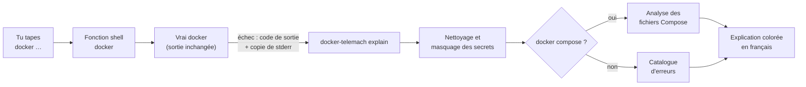

# TELEMACH PLUGIN DOCKER

**TELEMACH** est un plugin pédagogique pour Docker : quand une commande `docker` ou
`docker compose` échoue, il t'explique **en français** ce qui s'est passé, le concept Docker
en jeu, la cause probable et comment corriger, avec une sortie largement colorée.

```text
$ docker run -p 8080:80 nginx:1.30-alpine
docker: Error response from daemon: … Bind for 0.0.0.0:8080 failed: port is already allocated

✖ Le port 8080 de ta machine est déjà utilisé.

📘 Concept — port publishing
   L'option « -p PORT_MACHINE:PORT_CONTENEUR » relie un port de ta machine à un
   port du conteneur. Un port de la machine ne peut être relié qu'une seule fois.

🔎 Cause probable
   Un autre conteneur (ou un autre programme de ta machine) écoute déjà sur le port 8080.

💡 Corrections
   1. Voir quel conteneur publie déjà ce port.
      docker ps --filter publish=8080
   2. Publier le conteneur sur un autre port de ta machine.
      docker run -p 8081:80 nginx:1.30-alpine

➜ Pour aller plus loin : docker telemach deepen
```

## Le projet

Quand on apprend Docker, les erreurs arrivent vite, et elles sont écrites en anglais
technique : `Bind for 0.0.0.0:8080 failed`, `pull access denied`, `mapping values are not
allowed in this context`… Le message dit **ce qui** a échoué, rarement **pourquoi**, et
encore moins **ce qu'il faut comprendre** pour ne plus refaire l'erreur.

TELEMACH transforme chaque erreur en petite leçon. Le nom vient de Télémaque, le fils
d'Ulysse, guidé par Mentor dans *l'Odyssée* : le plugin joue ce rôle de mentor, au moment
précis où tu en as besoin, dans ton propre terminal.

Il s'adresse aux personnes qui débutent ou progressent avec Docker : étudiants, développeurs
qui découvrent les conteneurs, formateurs qui veulent un compagnon pour leurs travaux
pratiques.

## Le concept

### Une erreur = une leçon en quatre temps

Chaque explication suit toujours la même structure, pour que l'apprenant prenne l'habitude de
raisonner ainsi :

| Bloc | Rôle |
|------|------|
| ✖ **Résumé** | ce qui s'est passé, en une phrase |
| 📘 **Concept** | la notion Docker en jeu (image, conteneur, port, volume, réseau…), définie simplement |
| 🔎 **Cause probable** | pourquoi c'est arrivé ici |
| 💡 **Corrections** | ce que tu peux faire, avec la commande prête à copier |
| ⚠ **Anti-pattern** | la « solution rapide » à éviter, et pourquoi (`chmod 666`, `rm -f`…) |
| ➜ **Pour aller plus loin** | `docker telemach deepen` : le concept détaillé, un exemple, un exercice |

Le message Docker d'origine reste affiché, atténué, avec les éléments importants (port,
image, chemin) surlignés : on apprend aussi à lire soi-même les erreurs Docker.

### Trois principes

- **Ne jamais inventer.** Une erreur inconnue est présentée comme telle, avec des pistes et
  un lien vers la documentation officielle, mais sans cause supposée.
- **Ne jamais agir à ta place.** TELEMACH propose, tu décides : il n'exécute aucune commande
  et ne modifie aucun fichier.
- **Enseigner les bonnes pratiques.** Les exemples évitent root, `--privileged` et les
  secrets écrits en clair ; une solution dangereuse est toujours signalée comme telle.

### Comment ça marche



1. **Capture.** `shell-init` définit une fonction `docker` dans ton shell. Elle lance le vrai
   `docker` sans toucher à son entrée ni à sa sortie standard, et garde une copie de la
   sortie d'erreur dans un fichier temporaire privé (`0600`), supprimé juste après.
2. **Nettoyage.** Le texte capturé est traité comme non fiable : les séquences de contrôle du
   terminal sont neutralisées et les secrets (mots de passe, jetons, `user:motdepasse@`) sont
   masqués avant tout usage.
3. **Diagnostic.** Le **catalogue** (fichiers YAML en français, embarqués dans le binaire)
   reconnaît l'erreur grâce à des motifs. Le **code de sortie** indique si l'erreur vient de
   Docker (125) ou du programme du conteneur (126, 127, 137, 143 et les autres codes).
4. **Compose.** Pour `docker compose`, l'**analyseur** relit les fichiers Compose en lecture
   seule, avec le parseur officiel `compose-go`, pour pointer le fichier, la ligne et la clé
   exacts.
5. **Rendu.** L'explication est affichée sur la sortie d'erreur, avec un code couleur par
   bloc et la coloration syntaxique des commandes et des extraits YAML.

### Vérifier un fichier Compose avant de le lancer

```text
$ docker telemach check
✖ Problème 1/1 — compose.yaml:4:5
   service « web », clé « services.web.port »
   la clé « port » n'existe pas à cet endroit — tu voulais sans doute écrire « ports »

     1 │ services:
     2 │   web:
     3 │     image: nginx:1.30-alpine
   ➤ 4 │     port:
             ^
     5 │       - "8080:80"

   💡 Version corrigée
     4 │     ports:
```

L'analyse détecte : fichier introuvable ou illisible, tabulations, syntaxe YAML, clés en
double ou inconnues (avec la clé probable), types de valeurs incorrects, services, réseaux ou
volumes non déclarés, dépendances en boucle, variables non définies et secrets écrits en
clair.

## Installation

### Prérequis

| Outil | Version | Vérification |
|-------|---------|--------------|
| Go | 1.27 ou plus récent (la version exacte, 1.27.2, est téléchargée automatiquement par Go) | `go version` |
| Docker Engine ou Docker Desktop | avec le plugin Compose v2 | `docker version` et `docker compose version` |
| Shell | bash ou zsh (Linux, macOS, WSL2) | `echo $SHELL` |

Windows natif (PowerShell) n'est pas pris en charge ; sous Windows, utilise WSL2.

### 1. Compiler et installer le plugin

```bash
git clone https://github.com/aboigues/telemach-plugin-docker.git
cd telemach-plugin-docker
mkdir -p ~/.docker/cli-plugins
go build -o ~/.docker/cli-plugins/docker-telemach ./cmd/docker-telemach
```

Docker découvre automatiquement les plugins placés dans `~/.docker/cli-plugins/`. Vérifie :

```bash
docker telemach --help
docker --help | grep telemach    # « telemach*  Explique en français les erreurs… »
```

### 2. Activer l'explication automatique

Ajoute la ligne correspondant à ton shell à la fin de son fichier de configuration :

```bash
# zsh — dans ~/.zshrc
eval "$(docker telemach shell-init zsh)"

# bash — dans ~/.bashrc
eval "$(docker telemach shell-init bash)"
```

Puis ouvre un nouveau terminal (ou recharge la configuration avec `source ~/.zshrc`).

### 3. Tester

```bash
type docker              # « docker is a shell function » : l'intégration est active
docker run --rm ngnix    # faute de frappe volontaire : TELEMACH propose « nginx »
docker telemach deepen   # approfondit cette erreur
```

### Mettre à jour

```bash
cd telemach-plugin-docker
git pull
go build -o ~/.docker/cli-plugins/docker-telemach ./cmd/docker-telemach
```

### Désinstaller

1. Retire la ligne `eval "$(docker telemach shell-init …)"` de ton `~/.zshrc` ou `~/.bashrc`.
2. Supprime le plugin et son état local :

   ```bash
   rm ~/.docker/cli-plugins/docker-telemach
   rm -rf ~/.local/state/telemach
   ```

### Dépannage

| Symptôme | Cause probable et solution |
|----------|----------------------------|
| `docker: unknown command: docker telemach` | Le binaire n'est pas dans `~/.docker/cli-plugins/` ou n'est pas exécutable : relance l'étape 1. |
| Aucune explication après une erreur | Vérifie avec `type docker` que la fonction est active, et que `TELEMACH_DISABLE` n'est pas à `1`. |
| Pas de couleurs | La sortie n'est pas un terminal, ou `NO_COLOR` est défini. Force avec `--color=always`. |
| `go: downloading go1.27.2…` lors de la compilation | Normal : Go télécharge la bonne version de sa chaîne d'outils. |

## Commandes

| Commande | Rôle |
|----------|------|
| `docker telemach check [-f fichier]... [dossier]` | Vérifie un projet Compose **avant** de le lancer (code 0 : aucun problème, 1 : problème trouvé, 2 : fichier introuvable) |
| `docker telemach deepen [--exercise]` | Approfondit le concept de la dernière erreur expliquée |
| `docker telemach shell-init bash\|zsh` | Affiche le code d'intégration à évaluer dans ton shell |
| `docker telemach explain …` | Utilisée par l'intégration shell (tu n'as pas à l'appeler) |

## Confidentialité et sécurité

- Fonctionne **100 % en local**, sans aucun accès réseau.
- **N'exécute aucune commande** et ne modifie aucun de tes fichiers : il propose, tu décides.
  Seule exception : `docker --version`, lu une fois à l'activation pour connaître ta version
  de Docker.
- **Masque les secrets** (mots de passe, jetons, clés) partout où il affiche ou enregistre
  quelque chose.
- Le dernier diagnostic, déjà masqué, est conservé dans `~/.local/state/telemach/`
  (droits `0600`) pour la commande `deepen`.

## Couleurs

La sortie est colorée dans un terminal ; chaque bloc garde aussi un symbole et un libellé
(✖, 📘, 🔎, 💡, ⚠), pour rester lisible sans couleur.

- `--color=auto|always|never` (par défaut `auto`) ;
- `NO_COLOR=1` désactive les couleurs, `CLICOLOR_FORCE=1` les force ;
- la palette s'adapte aux fonds clairs et sombres (variable `COLORFGBG` ou interrogation du
  terminal).

## Désactivation ponctuelle

```bash
TELEMACH_DISABLE=1 docker …
```

## Contribuer

Le projet suit une [constitution](.specify/memory/constitution.md) : pédagogie, français
pour l'humain et anglais pour le code, sécurité élevée, gates GitHub Actions obligatoires et
mémoire des incidents ([`LESSON-LEARNED.md`](LESSON-LEARNED.md)). Voir
[`CONTRIBUTING.md`](CONTRIBUTING.md) et, pour enrichir le catalogue d'erreurs,
[`docs/catalogue.md`](docs/catalogue.md).

Signalement de vulnérabilité : voir [`SECURITY.md`](SECURITY.md).
